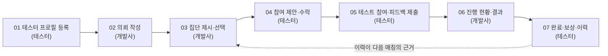

# 플레이핏(PlayFit) UI/UX 데모 시안 저장소

> "개발사에는 필요한 테스터 집단을, 게이머에게는 맞는 테스트 기회를."

플레이핏은 개발사가 원하는 유형의 테스터 집단을 매칭하고, 게이머의 경험과 테스트 활동을 프로필로 쌓아 다음 기회로 잇는 게임 테스터 매칭 플랫폼입니다.
이 저장소는 캡스톤 사업계획서에 넣을 **UI/UX 데모 화면 시안과 화면 녹화 영상**을 유저 흐름 순서대로 모아 둡니다.

- 팀: NeckSlice
- 데모 기준: **2028년 관리형 단계의 목표 화면**(개발사 웹 의뢰 + 테스터 집단 자동 제시)
- 데모 시나리오: 로그라이크 게임 튜토리얼 테스트 → 장르 초보 6명 + 경험자 6명, 모두 해당 게임 첫 이용자, 개발사 부담 42만원(매칭료 24만원 + 테스터 보상 18만원)

## 유저 흐름



## 진행 현황

상태: ⬜ 미작업 · 🟨 시안 · ✅ 확정

| 단계 | 폴더 | 화면 | 사용자 | 시안 | 영상 |
|---|---|---|---|---|---|
| 01 | [01_tester-profile](01_tester-profile/) | 테스터 프로필 등록 | 테스터 | ⬜ | ⬜ |
| 02 | [02_request-create](02_request-create/) | 의뢰 작성 | 개발사(기관 담당자) | ⬜ | ⬜ |
| 03 | [03_group-proposal](03_group-proposal/) | 집단 제시·선택 | 개발사 | ⬜ | ⬜ |
| 04 | [04_offer-accept](04_offer-accept/) | 참여 제안·수락 | 테스터 | ⬜ | ⬜ |
| 05 | [05_test-feedback](05_test-feedback/) | 테스트 참여·피드백 제출 | 테스터 | ⬜ | ⬜ |
| 06 | [06_progress-result](06_progress-result/) | 진행 현황·결과 | 개발사 | ⬜ | ⬜ |
| 07 | [07_reward-history](07_reward-history/) | 완료·보상·이력 | 테스터 | ⬜ | ⬜ |
| — | [99_full-demo-video](99_full-demo-video/) | 전체 데모 영상 | — | — | ⬜ |

## 폴더 구조

```
UX-UI_design_templete/
├─ README.md                 지금 보는 문서
├─ CONTRIBUTING.md           파일 이름·브랜치·PR 규칙
├─ docs/
│  ├─ demo-flow.md           7단계 흐름 표와 사업계획서 근거
│  └─ video-guide.md         화면 녹화 규칙
├─ 01_tester-profile/  ~  07_reward-history/
│    ├─ README.md            사용자, 담을 내용, 화면 순서표
│    ├─ prototypes/          화면 시안 HTML (파일 하나로 브라우저에서 바로 열림)
│    ├─ video/               이 단계 화면 녹화 MP4
│    └─ archive/             이전 버전 HTML
└─ 99_full-demo-video/       전체 영상 링크, 스토리보드
```

이 저장소는 **완성된 서비스 코드가 아니라 시나리오별 화면 시안을 보관하는 곳**입니다. 빌드나 실행 환경 없이, 각 HTML 파일을 브라우저로 열어 보면 됩니다.

## 시작하기

1. [CONTRIBUTING.md](CONTRIBUTING.md)에서 파일 이름 규칙과 브랜치 규칙을 확인합니다.
2. 맡은 단계 폴더의 README에 있는 "담을 내용"을 모두 넣었는지 확인하며 HTML 시안을 만듭니다.
3. 시안을 그 단계의 `prototypes/`에 넣고, `design/단계-폴더명` 브랜치에서 PR을 엽니다.
4. 영상을 올리려면 Git LFS를 먼저 설치합니다: `git lfs install`

## 참고 문서

- 사업계획서: 12_NeckSlice 사업계획서(플레이핏) — 1-2 기능 및 기대효과, 2-1 사용방법·핵심기능·차별성, UI/UX 데모 버전 개발
